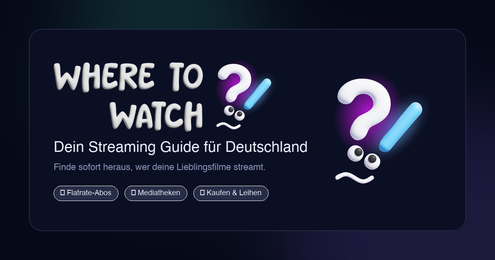

# Where to Watch 🎬

[](https://ved-io.github.io/where-to-watch/)
[](./LICENSE)
[](https://www.w3.org/WAI/standards-guidelines/wcag/)
[](#-datenschutz--privacy-by-design)
[](./manifest.webmanifest)
[](https://developer.mozilla.org/de/docs/Web/JavaScript)
[](https://tailwindcss.com/)

**Where to Watch** ist eine moderne, datenschutzfreundliche und barrierefreie Streaming-Guide-Web-App (PWA): Wähle einen Film oder eine Serie aus und sieh sofort, **bei welchem Streamingdienst in Deutschland der Titel verfügbar ist** – im Flatrate-Abo, kostenlos in Mediatheken oder zum Kaufen/Leihen – inklusive Besetzung, Bewertung, Laufzeit und Synopsis.

Gebaut mit Fokus auf Performance, Barrierefreiheit (WCAG 2.1 AA), Ergonomie durch echte Nutzertests und kompromisslose Privatsphäre – ganz ohne schwerfällige Frameworks oder Build-Schritte.

---

## 📸 Screenshots & Vorschau

<!-- 
Tipp: Platziere deine Screenshots in assets/screenshots/ und verlinke sie hier.
Empfohlene Dateinamen: preview-hero.png, preview-modal.png, preview-watchlist.png
-->

<div align="center">
  
</div>

---

## ✨ Features & Highlights

- 🔍 **Live-Suche & Filter**: Debounced Suche nach Titeln, Filter nach Streaming-Anbietern (Netflix, Prime Video, Disney+, Apple TV+, etc.) und Genres.
- ♿ **Barrierefrei (WCAG 2.1 AA)**: Konzipiert für Screenreader, vollständige Tastaturbedienung, hohe Kontraste und Unterstützung für `prefers-reduced-motion`.
- 🧪 **Nutzertest-optimiert (User-Centric UX)**: Layout, Informationsdichte und Provider-Abzeichen basieren auf qualitativen Usability-Tests für intuitive Orientierung.
- 🔒 **100 % Datenschutzkonform**: Keine Cookies, kein Tracking, keine Datensammelei. Alle persönlichen Daten (Watchlist) verbleiben ausschließlich lokal im Browser.
- 📱 **Progressive Web App (PWA)**: Installierbar auf iOS, Android und Desktop. Zuverlässiger Offline-Modus via Service Worker mit resilientem Pre-Caching.
- ⭐ **Persistente Watchlist**: Speichere Lieblingstitel lokal im Browser (`localStorage`), ohne Account- oder Cloud-Zwang.
- 🎨 **Adaptive Oberfläche**: Dunkles Apple-inspiriertes Designsystem (*Nocturne Cinema*) mit flüssigen Übergängen (`cubic-bezier`) und responsiver Grid-Architektur.
- ⚡ **Zero-Build**: Reines semantisches HTML5, Tailwind CSS Tokens und Vanilla JavaScript – läuft sofort ohne npm/Webpack/Vite.

---

## ♿ Barrierefreiheit (A11y & WCAG 2.1 AA)

Where to Watch wurde von Grund auf nach den Kriterien der **Web Content Accessibility Guidelines (WCAG 2.1 Level AA)** gestaltet:

- **Semantische Struktur:** Logischer Aufbau mit HTML5-Landmarks (`<header>`, `<main>`, `<nav>`, `<footer>`) und korrekter Überschriften-Hierarchie (`h1` bis `h3`).
- **Screenreader-Unterstützung:** Präzise `aria-label`-, `aria-live`- und `role`-Attribute für dynamische Inhalte (Suchergebnisse, Toasts, Filter-Status und Modals).
- **Tastaturnavigation:** Alle interaktiven Elemente (Buttons, Karten, Modals, Filter) sind über die Tab-Taste fokussierbar und besitzen sichtbare Fokus-Ringe. Das Detail-Modal bietet einen automatischen Focus-Trap und schließt auf `Escape`.
- **Kontraste & Lesbarkeit:** Farbpaletten und Typografie erfüllen die strengen Kontrastanforderungen (mindestens 4.5:1 für Fließtext, 3:1 für Grafikelemente).
- **Motion Accessibility:** Respektiert Systemeinstellungen für reduzierte Bewegung (`@media (prefers-reduced-motion: reduce)`) – Animationen und Übergänge werden bei Bedarf deaktiviert.

---

## 🧪 Usability & Nutzertests (User-Centric Design)

Die Benutzeroberfläche und Bedienlogik wurden nicht nur theoretisch entworfen, sondern durch strukturierte **User-Tests** iterativ optimiert:

1. **State-Aware Header:** Tests zeigten, dass Nutzer beim Scrollen die Filter- und Suchkontrolle nicht verlieren wollen. Ein kompakter Sticky Header dockt sich beim Herabscrollen nahtlos oben an.
2. **Provider-Klarheit:** Tester wünschten sich eine sofortige visuelle Trennung zwischen *Flatrate-Abo*, *Kostenlosen Mediatheken* und *Kauf/Leih-Optionen*. Anbieter-Badges heben Flatrate-Streaming visuell hervor.
3. **Modal-Ergonomie:** Das Detail-Modal fasst Synopsis, Regie, Hauptdarsteller und Streaming-Links zusammenhängend zusammen, ohne den Nutzer auf externe Seiten zwingen zu müssen.

---

## 🔒 Datenschutz & Privacy by Design (DSGVO)

Where to Watch respektiert die Privatsphäre der Nutzer vollumfänglich:

- **Keine Tracking-Cookies oder Werbe-Pixel**: Es kommen weder Google Analytics, Werbenetzwerke noch Fingerprinting-Dienste zum Einsatz.
- **Keine Server-Datenspeicherung**: Die App benötigt keinen Nutzer-Account. Die Watchlist sowie Anzeigeeinstellungen werden ausschließlich lokal im Speicher deines Browsers (`localStorage`) abgelegt.
- **Keine Third-Party-Server-Verarbeitung**: Die Metadaten- und Streaming-Abfragen erfolgen direkt clientseitig über verschlüsselte HTTPS-Verbindungen (TLS 1.3) zur TMDB-API.

---

## 🚀 Schnellstart

Da die App ohne Build-Tools (kein Node.js/Webpack/Vite nötig) auskommt, kann sie direkt gestartet werden:

### 1. Repository klonen
```bash
git clone https://github.com/ved-io/where-to-watch.git
cd where-to-watch
```

### 2. Konfiguration einrichten
Kopiere das Konfigurationstemplate:
```bash
cp js/config.example.js js/config.js
```
Öffne `js/config.js` und trage deinen persönlichen **TMDB API Read-Access Token** ein:
1. Kostenlosen Account auf [themoviedb.org](https://www.themoviedb.org/) erstellen.
2. Unter [Einstellungen → API](https://www.themoviedb.org/account/api) einen **API Read Access Token** (v4 Bearer Token) generieren.
3. Den Token in `js/config.js` einfügen.

> 🔒 **Sicherheitshinweis**: `js/config.js` ist in `.gitignore` hinterlegt und wird niemals in das GitHub-Repository übertragen. Dein Token bleibt geschützt.

### 3. Lokal starten
Starte einen beliebigen lokalen Webserver (z. B. mit Python):
```bash
python3 -m http.server 8000
```
Öffne anschließend [http://localhost:8000](http://localhost:8000) im Browser.

---

## 🌐 Deployment

### Auf eigenem Webhost (Apache / Nginx / Shared Hosting)
1. Lade alle Dateien des Projekts auf deinen Webspace (z. B. per SFTP).
2. Stelle sicher, dass deine `js/config.js` mit deinem gültigen API-Token auf dem Server liegt.
3. Fertig! Die Seite ist sofort für alle Besucher einsatzbereit.

### Auf GitHub Pages
1. Aktiviere GitHub Pages in den Repository-Einstellungen (`Settings` → `Pages` → `Source: GitHub Actions`).
2. Da `js/config.js` nicht im öffentlichen Git-Repository liegt, bietet die Web-App bei Aufruf auf GitHub Pages automatisch einen Dialog zur Eingabe eines individuellen TMDB-Tokens an. Dieser wird sicher im lokalen Speicher (`localStorage`) des jeweiligen Nutzers hinterlegt.

---

## 📁 Projektstruktur

```text
.
├── assets/                     # Logos, Marken-Grafiken & Favicons
│   ├── icons/                  # PWA-Icons in allen Auflösungen & Maskables
│   ├── screenshots/            # App-Screenshots für Dokumentation
│   └── wtw-*.png / wtw-*.svg   # Nocturne Cinema Logos
├── css/
│   └── style.css               # Design-Tokens, Glasmorphismus & Animationen
├── js/
│   ├── app.js                  # Kern-Applikation (State, Caching, TMDB-API)
│   ├── config.example.js       # Konfigurations-Template für TMDB-Credentials
│   └── config.js               # Lokale Konfiguration (durch .gitignore geschützt)
├── .github/workflows/          # GitHub Actions (Automatisches Pages Deployment)
├── .gitignore                  # Schützt private Keys & Betriebssystemdateien
├── favicon.ico                 # Standard-Favicon Fallback
├── index.html                  # Semantisches HTML5 Markup & App-Shell
├── LICENSE                     # MIT Lizenz
├── manifest.webmanifest        # PWA-Manifest (Theme-Farben, Shortcuts)
├── README.md                   # Projektdokumentation
└── sw.js                       # Service Worker (Offline-Cache & Strategien)
```

---

## 🛠️ Datenquellen & Attribution

- **Metadaten, Poster & Besetzung**: Bereitgestellt von [The Movie Database (TMDB)](https://www.themoviedb.org/).
- **Streaming-Verfügbarkeit**: Ermittelt über JustWatch (über die offizielle TMDB Watch-Providers API).
- Dieses Produkt nutzt die TMDB-API, wird jedoch nicht von TMDB oder JustWatch unterstützt oder zertifiziert.

---

## 📄 Lizenz

Dieses Projekt ist unter der [MIT-Lizenz](./LICENSE) lizenziert.
